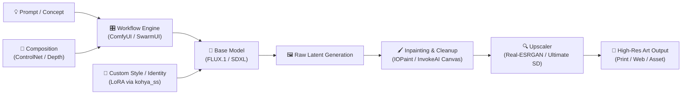

  

  
  
  
  
  

  <b>A curated, SEO-indexed directory of leading commercial SaaS platforms and high-performance open-source GitHub projects for Generative AI Art, Diffusion Workflows, and Neural Image Generation.</b>

---

## Table of Contents

- [Overview](#overview)
- [Sector Overview & Market Dynamics](#sector-overview--market-dynamics)
- [Leading SaaS & Hosted Platforms](#leading-saas--hosted-platforms)
- [Open-Source GitHub Projects](#open-source-github-projects)
  - [Web User Interfaces & Creative Suites](#web-user-interfaces--creative-suites)
  - [Foundational Open-Weight Diffusion Models](#foundational-open-weight-diffusion-models)
  - [Conditioning, Inpainting, Upscaling & Training Tools](#conditioning-inpainting-upscaling--training-tools)
- [Ecosystem Architecture & Pipeline Guide](#ecosystem-architecture--pipeline-guide)
- [Frequently Asked Questions (FAQ)](#frequently-asked-questions-faq)
- [How to Contribute](#how-to-contribute)
- [Disclaimer & Licensing](#disclaimer--licensing)

---

## Overview

Generative AI Art has evolved from experimental research into mission-critical creative infrastructure for concept artists, game studios, visual designers, and developers. This repository tracks both ends of the spectrum:

1. **Enterprise & Prosumer SaaS Platforms**: Turnkey cloud systems with proprietary model weights, curated prompt engines, rapid iteration canvases, and commercial indemnification.
2. **Open-Source & Self-Hosted Toolchains**: Open-weight diffusion models, modular node graphs, local web UIs, and low-rank adaptation (LoRA) fine-tuning tools that run on consumer and workstation GPUs without per-image billing or cloud dependencies.

---

## Sector Overview & Market Dynamics

The global market for Generative AI in visual media, digital art, and creative design is estimated at **$2.1 billion in 2024–2025** and is projected to expand to **$13.8 billion by 2032**, demonstrating an annualized compound growth rate (CAGR) of ~31.5%.

Rather than a winner-take-all monopoly, the sector exhibits **moderate fragmentation**:
- **Frontier Cloud Concentration**: Upstream foundational compute and closed-source model checkpoints remain concentrated among deep-pocketed hyperscalers and labs (Adobe, OpenAI, Midjourney).
- **Application & Open Ecosystem Dispersion**: Downstream visual tooling remains fiercely competitive and differentiated. Open-weight breakthroughs (FLUX.1, SDXL) coupled with modular graphical orchestrators (ComfyUI) allow independent developers, game studios, and specialized SaaS apps (Recraft for vectors, Ideogram for typography, Leonardo for game assets) to circumvent vendor lock-in.

---

## Leading SaaS & Hosted Platforms

The table below catalogs commercial text-to-image and generative visual suites, sorted in descending order by parent company scale (valuation or market capitalization):

| Platform | Company Valuation / Revenue | Pricing (Starting Paid Tier) | Free Tier Limits | Core Focus & Best Use Cases |
| :--- | :--- | :--- | :--- | :--- |
| **[Adobe Firefly](https://www.adobe.com/products/firefly.html)** | **~$230B Market Cap** (~$24B ARR) | **$4.99 / month** (Firefly Premium Plan for 100 credits/mo; or included in Photoshop/Creative Cloud plans from $9.99/mo) | **25 generative credits/month** with free Adobe ID (resets monthly; non-commercial license, watermarked downloads, standard queue speed) | Enterprise IP indemnity; native integration inside Adobe Photoshop (Generative Fill, Generative Expand) and Illustrator vector recoloring. |
| **[DALL-E 3 (OpenAI)](https://openai.com/dall-e-3)** | **~$157B Valuation** (~$4B+ ARR) | **$20.00 / month** (ChatGPT Plus plan with multimodal GPT-4o & DALL-E 3; or API at $0.040–$0.080/image) | **2 image generations per 24 hours** on ChatGPT Free tier (resets on rolling 24-hr window; standard 1024x1024 resolution) | Unrivaled conversational prompt adherence; complex spatial composition and contextual image revisions through natural dialogue. |
| **[Leonardo.ai](https://leonardo.ai/)** | **~$38B Valuation** (Acquired by Canva; ~$2.5B ARR) | **$12.00 / month** ($10.00/mo billed annually on Apprentice Plan for 8,500 fast tokens/mo) | **150 fast generation tokens per day** (resets every 24 hours; generates ~15–75 images/day based on pipeline, standard queue access) | Game asset generation, character model sheets, environment textures, built-in LoRA training, and Canvas inpainting/outpainting. |
| **[Midjourney](https://www.midjourney.com/)** | **~$10B Valuation** (~$500M ARR; Bootstrapped) | **$10.00 / month** ($8.00/mo billed annually on Basic Plan for 3.3 hrs/mo Fast GPU time, ~200 generations) | **No ongoing free tier**; requires minimum $10/mo subscription (occasional promotional weekend access periods or legacy 25-trial jobs) | Gold standard for cinematic aesthetics, photorealism, artistic style rendering, lighting fidelity, and prompt elegance via Discord & Web. |
| **[Ideogram](https://ideogram.ai/)** | **~$500M–$600M Valuation** (Series A; a16z backed) | **$8.00 / month** ($7.00/mo billed annually on Basic Plan for 400 priority prompt credits / ~1,600 images/mo) | **10 slow credits per day** (resets daily at 00:00 UTC; yields up to 40 images/day with public gallery publishing and standard queue) | Best-in-class in-image typography, legible signage, t-shirt graphics, typography posters, and graphic design sticker creation. |
| **[Krea AI](https://www.krea.ai/)** | **~$500M Valuation** ($83M Series B; ~$10M ARR) | **$10.00 / month** ($8.00/mo billed annually on Basic Plan for 100 fast daily generations + real-time canvas) | **100 compute units per day** (resets every 24 hours; yields ~10–15 real-time canvas generations/day, standard generation queue) | Ultra-low-latency real-time canvas (generates as you brush/draw), AI upscaling, style transfer, and real-time interactive generation. |
| **[Recraft](https://www.recraft.ai/)** | **~$120M Valuation** (Series B; Accel backed) | **$12.00 / month** ($10.00/mo billed annually on Basic Plan for 1,000 credits/mo) | **50 free credits per day** (resets daily; provides ~50 raster/vector generations/day, public gallery, commercial usage permitted) | Native infinite-resolution SVG vector art generation, brand consistency, icon design sets, and graphic design style boards. |
| **[NightCafe Studio](https://creator.nightcafe.app/)** | **~$15M–$25M Valuation** (Profitable; 25M+ users) | **$5.99 / month** ($4.79/mo billed annually on AI Beginner for 100 credits/mo + daily credits) | **5 free credits per day** upon login + **2 bonus credits per day** for voting in daily challenge (total 7 credits/day; standard SD models free) | Multi-model playground aggregating FLUX, SDXL, and DALL-E 3 with gamified daily community art challenges and collaborative rooms. |

---

## Open-Source GitHub Projects

The open-source generative AI art ecosystem enables local GPU execution without subscription costs or platform censorship. The projects below are **strictly sorted in descending order by GitHub stargazers count**, with dynamic social badges linking directly to each repository's stargazers.

### Web User Interfaces & Creative Suites

1. **[AUTOMATIC1111 / stable-diffusion-webui](https://github.com/AUTOMATIC1111/stable-diffusion-webui)**   
   The pioneer browser-based interface for Stable Diffusion. Features an extensive ecosystem of community extensions, checkpoint management, prompt matrices, inpainting, outpainting, textual inversion, and scripts.  
   - **Best for:** Beginners and users seeking an all-in-one classic tabbed UI with rich community extension support.

2. **[comfyanonymous / ComfyUI](https://github.com/comfyanonymous/ComfyUI)**   
   The industry standard node-based visual programming interface and execution backend for diffusion models. Wires checkpoints, VAEs, samplers, LoRAs, and ControlNets into fully reproducible graph pipelines.  
   - **Best for:** Advanced workflows, production pipelines, video diffusion, and immediate day-zero support for newly released architectures (FLUX, SDXL, SD 3.5).

3. **[lllyasviel / Fooocus](https://github.com/lllyasviel/Fooocus)**   
   An image generating software based on SDXL that combines the prompt simplicity of Midjourney with the local independence of open weights. Automates sampling parameters, prompt expansion, and style presets behind an effortless interface.  
   - **Best for:** Casual creators who want Midjourney-level quality locally without adjusting technical hyperparameters.

4. **[invoke-ai / InvokeAI](https://github.com/invoke-ai/InvokeAI)**   
   A creative engine designed for visual artists and design studios. Offers an industry-grade Unified Canvas for multi-layer composition, regional prompting, precise inpainting, and structured asset boards.  
   - **Best for:** Professional digital artists and illustrators needing fine-grained canvas editing without node complexity.

5. **[lllyasviel / stable-diffusion-webui-forge](https://github.com/lllyasviel/stable-diffusion-webui-forge)**   
   A high-performance fork of Automatic1111 featuring rewritten attention mechanisms, optimized layer management, and significant VRAM reduction. Natively runs FLUX.1 and SDXL on low-to-mid tier consumer GPUs.  
   - **Best for:** Users who love the classic WebUI layout but require modern speed optimizations and FLUX/SDXL compatibility on modest hardware.

6. **[Acly / krita-ai-diffusion](https://github.com/Acly/krita-ai-diffusion)**   
   Native generative AI plugin for the open-source Krita digital painting suite. Delivers real-time canvas generation, inpainting, ControlNet guidance, and layer-aware style generation directly within an artist's digital brush workflow.  
   - **Best for:** Illustrators and concept artists blending manual digital painting with AI generation.

7. **[easydiffusion / easydiffusion](https://github.com/easydiffusion/easydiffusion)**   
   Zero-hassle, 1-click installer and user-friendly GUI for running Stable Diffusion locally on Windows, macOS, and Linux without Python or CUDA command-line configuration.  
   - **Best for:** Non-technical creators wanting an instant local install experience.

8. **[mcmonkeyprojects / SwarmUI](https://github.com/mcmonkeyprojects/SwarmUI)**   
   Modular, fast, and extensible web interface for image and video diffusion powered by a ComfyUI backend. Features batch queuing, multi-GPU generation swarms, and a rich parameter control dashboard.  
   - **Best for:** Power users and studio teams orchestrating multi-GPU rendering swarms.

---

### Foundational Open-Weight Diffusion Models

1. **[CompVis / stable-diffusion](https://github.com/CompVis/stable-diffusion)**   
   The landmark latent text-to-image diffusion model developed by CompVis, LMU Munich, and Runway that democratized generative AI art. Forms the foundation for the SD 1.4/1.5 ecosystem.  
   - **License:** CreativeML OpenRAIL-M.

2. **[Stability-AI / generative-models (SDXL)](https://github.com/Stability-AI/generative-models)**   
   Official codebase for Stable Diffusion XL (SDXL 1.0) and Stable Video Diffusion (SVD). SDXL features a 3.5B dual-text-encoder architecture that serves as the backbone for thousands of community-trained art checkpoints and LoRAs.  
   - **License:** OpenRAIL++ (Commercial use allowed with conditions).

3. **[black-forest-labs / flux](https://github.com/black-forest-labs/flux)**   
   State-of-the-art 12-billion parameter rectified-flow transformer model developed by the original authors of Stable Diffusion. Delivers benchmark-setting photorealism, typography fidelity, and prompt comprehension. Available in `[schnell]` (4-step distilled Apache 2.0) and `[dev]` (non-commercial open-weights).  
   - **License:** Apache 2.0 (`schnell`) / Non-Commercial (`dev`).

4. **[zai-org / GLM-Image](https://github.com/zai-org/GLM-Image)**   
   A 16-billion parameter open-weight diffusion model with a specialized Glyph Encoder dedicated to flawless text and typography rendering on banners, signage, and labels.  
   - **License:** Permissive MIT License.

---

### Conditioning, Inpainting, Upscaling & Training Tools

1. **[xinntao / Real-ESRGAN](https://github.com/xinntao/Real-ESRGAN)**   
   Practical super-resolution and image enhancement network. Restores high-frequency textures, cleans compression artifacts, and upscales AI art outputs up to 4x–8x cleanly.  
   - **Best for:** Preparing generated artwork for high-resolution print or poster publishing.

2. **[huggingface / diffusers](https://github.com/huggingface/diffusers)**   
   The premiere PyTorch toolbox for diffusion models across vision, audio, and video modalities. Powers most Python backend implementations and model training pipelines across the industry.  
   - **Best for:** Developers and researchers building custom programmatic generation pipelines.

3. **[lllyasviel / ControlNet](https://github.com/lllyasviel/ControlNet)**   
   Neural network structure that adds spatial conditioning to text-to-image diffusion models via Canny edges, depth maps, human poses (OpenPose), normal maps, and segmentation masks.  
   - **Best for:** Strict composition control, character pose preservation, and architectural accuracy.

4. **[Sanster / IOPaint](https://github.com/Sanster/IOPaint)**   
   Modern open-source inpainting, object removal, and outpainting suite (formerly known as *Lama Cleaner*). Powered by state-of-the-art inpainting models including LaMa, MAT, and Stable Diffusion Inpainting.  
   - **Best for:** Instant object erasing, watermark removal, and background expansion.

5. **[Mikubill / sd-webui-controlnet](https://github.com/Mikubill/sd-webui-controlnet)**   
   Official WebUI integration for ControlNet. Enables multi-ControlNet stacks, preprocessor inspection, and real-time pose guidance inside the Automatic1111 environment.  
   - **Best for:** A1111 users requiring compositional and structural guidance.

6. **[bmaltais / kohya_ss](https://github.com/bmaltais/kohya_ss)**   
   Comprehensive GUI and training suite for LoRA, LyCORIS, DreamBooth, and fine-tuning SD 1.5, SDXL, and FLUX models.  
   - **Best for:** Creators and studios training custom art styles, consistent characters, or specific brand identities.

7. **[Nerogar / OneTrainer](https://github.com/Nerogar/OneTrainer)**   
   A unified, modular training tool for diffusion models featuring memory-efficient fine-tuning, customizable loss functions, and a clean graphical configuration interface.  
   - **Best for:** Precision model tuning and multi-concept training on consumer GPUs.

---

## Ecosystem Architecture & Pipeline Guide

To build an efficient, cost-effective creative pipeline, combine modular open-source building blocks:

- **Rapid Prototyping**: Use **Krea AI** or **Fooocus** for instant concept validation and zero-configuration exploration.
- **Graphic Design & Typography**: Use **Ideogram** (cloud) or **GLM-Image** / **FLUX.1 [dev]** (local) for sharp text rendering and layout signage.
- **Vector Branding & Iconography**: Use **Recraft** for infinite SVG vector exports and cohesive design systems.
- **Production Asset Pipeline**: Build in **ComfyUI** with **FLUX.1** or **SDXL**, conditioned with **ControlNet** and refined via **IOPaint** and **Real-ESRGAN**.

---

## Frequently Asked Questions (FAQ)

### 1. Which AI art generator is best for commercial use?
- **Cloud/SaaS**: **Adobe Firefly** provides full commercial indemnification, as training data is strictly sourced from licensed Adobe Stock. **Recraft** explicitly permits commercial use of generated SVG and raster art on both free and paid plans.
- **Open-Source**: **FLUX.1 [schnell]** is released under the permissive Apache 2.0 license. **SDXL** allows commercial exploitation under OpenRAIL++ terms, provided acceptable use guidelines are followed.

### 2. What hardware specifications are required to run models locally?
- **Entry Level (8GB VRAM)**: Can run SD 1.5, SDXL (with FP8 quantization or xFormers), and GGUF quantized variants of FLUX via **SD-WebUI Forge** or **ComfyUI**.
- **Recommended (12GB–16GB VRAM)**: RTX 3060/4070 series allows smooth native SDXL generation, multi-ControlNet workflows, and FLUX.1 FP8 execution.
- **Professional (24GB+ VRAM)**: RTX 3090/4090 or workstation GPUs are recommended for running unquantized FP16 FLUX.1 [dev], local model fine-tuning with **kohya_ss**, and high-resolution video diffusion pipelines.

### 3. How does ComfyUI compare to Automatic1111?
- **ComfyUI** executes as a direct acyclic graph (DAG), loading only required model components into memory, making it dramatically faster and more VRAM-efficient. It is the platform of choice for cutting-edge techniques.
- **Automatic1111** provides a traditional web form layout that is intuitive for beginners, but lacks the granular workflow control and memory efficiency of node-based architectures.

---

## How to Contribute

We welcome additions, corrections, and benchmark updates from the community!

1. **Fork the repository** to your personal GitHub account.
2. **Add or update entries**:
   - For SaaS tools: ensure exact starting pricing and specific free tier limits are provided.
   - For open-source repos: include accurate repository links, stargazers badges, and place in the star-sorted hierarchy.
3. **Submit a Pull Request** with a concise description of your changes.

---

## Disclaimer & Licensing

- This repository is a community-maintained index for research, creative workflows, and educational purposes.
- All product names, trademarks, and registered trademarks belong to their respective owners.
- "Open-source" in generative diffusion typically denotes open-weight checkpoints; review individual model licenses (Apache 2.0, OpenRAIL, Non-Commercial) before commercial deployment.
